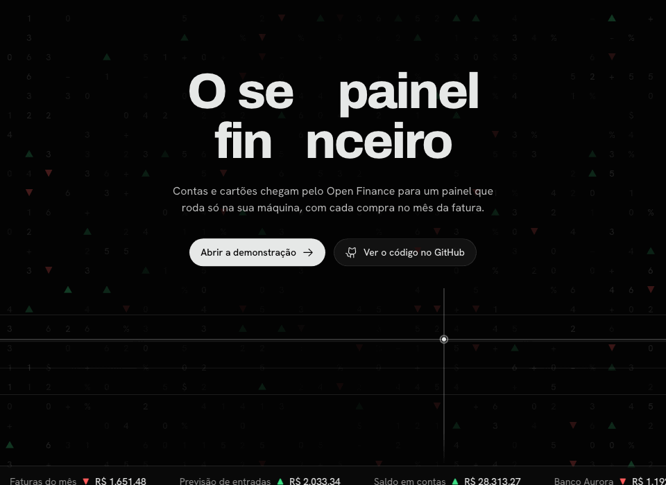
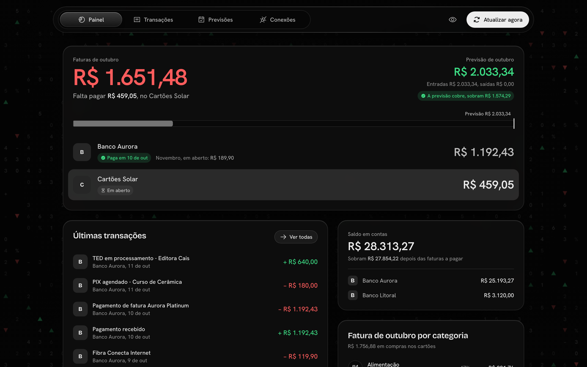
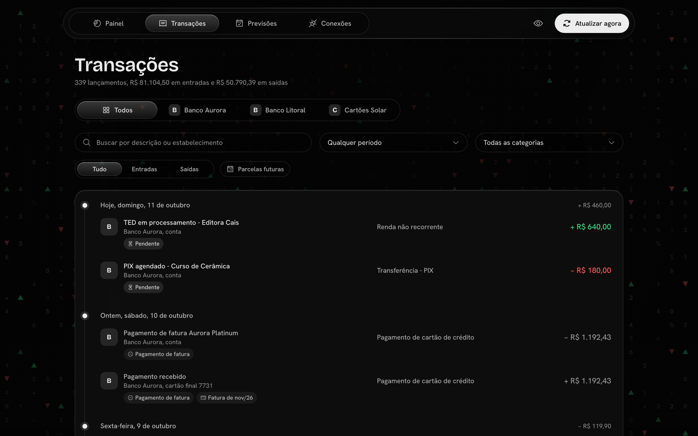
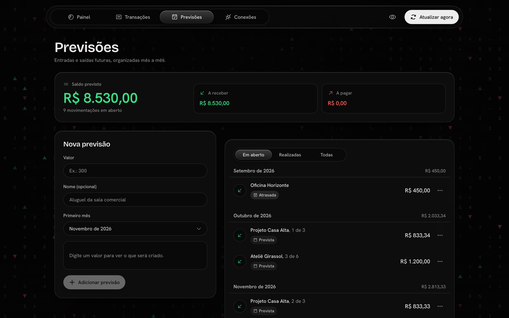
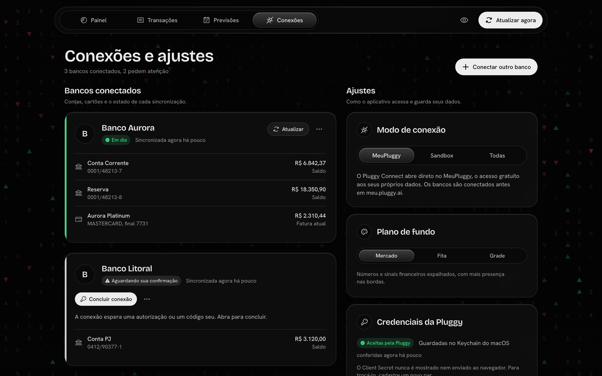

<div align="center">



<br>


**[Ver a demonstração](https://catmaitachi.github.io/financeiro/)** · [Começar](#começar) · [Conectar agentes](#conectar-agentes-mcp) · [Regras de consolidação](#regras-de-consolidação) · [Arquitetura](#arquitetura) · [Design](DESIGN.md)

</div>

<br>

O Financeiro junta as contas e os cartões dos seus bancos pela [Pluggy](https://pluggy.ai) e conta cada gasto de cartão no mês da fatura. Dá para pesquisar qualquer lançamento, e o que ainda vai entrar e sair fica numa previsão que recebe baixa sozinha quando o dinheiro aparece.

O Open Finance só existe no Brasil, então tudo aqui é em português, com reais, fuso `America/Sao_Paulo` e bancos brasileiros.

Frontend em React e TypeScript, backend em Node.js, banco SQLite local. Sem hospedagem, sem login, sem dependência nativa para compilar.

Quer ver antes de instalar? A [demonstração](https://catmaitachi.github.io/financeiro/) é o aplicativo de verdade rodando inteiro no navegador, com bancos e lançamentos fictícios.

<br>

<h2 align="center">01 · Painel do mês</h2>

<div align="center">



</div>

O Painel mostra quanto falta pagar de fatura, quanto está previsto para entrar e se uma coisa cobre a outra. Cada cartão traz a fatura atual, se já foi paga ou quando vence, e o que já caiu na fatura seguinte. Abaixo ficam as últimas transações, o saldo em contas depois das faturas a pagar e a fatura do mês por categoria. O olho na barra do topo oculta os valores.

<br>

<h2 align="center">02 · Transações</h2>

<div align="center">



</div>

As transações de todos os bancos ficam numa linha do tempo só, da mais recente para a mais antiga. Dá para filtrar por banco, período, categoria e direção, e buscar pela descrição ou pelo estabelecimento. Pagamentos de fatura e transferências entre as suas próprias contas ficam fora dos totais, para o mesmo dinheiro não entrar duas vezes. Se a categoria que a Pluggy sugeriu estiver errada, você corrige, e a correção sobrevive a qualquer sincronização.

<br>

<h2 align="center">03 · Previsões</h2>

<div align="center">



</div>

Uma previsão é uma expressão curta: `1.200*6` são seis meses de R$ 1.200,00, e `2.500/3` são R$ 2.500,00 divididos em três parcelas, com os centavos ajustados. A frequência é mensal, semanal ou diária, e a contagem segue a frequência (`50*4` semanal são quatro semanas). Na mensal, o dia é opcional; na semanal e na diária, a previsão começa numa data. Só as previsões com dia aparecem no calendário. Quando a movimentação chega ao banco, o Financeiro dá a baixa sozinho, mas só se houver uma única previsão e uma única movimentação possíveis, com a mesma direção, o mesmo valor e a competência esperada. Valor repetido, mês adiantado ou atrasado vai para a fila de revisão, e um vínculo que você desfez ou recusou não é refeito sozinho.

<br>

<h2 align="center">04 · Calendário e assinaturas</h2>

O Calendário mostra, dia a dia, o fechamento e o vencimento das faturas de cada banco (estimados pelo ciclo anterior enquanto o banco não entrega a fatura), as cobranças das assinaturas e as previsões com dia. O Painel traz o resumo dos próximos sete dias.

Assinaturas tem seção própria. À esquerda ficam as ativas, com o custo mensal somado; à direita, as compras recorrentes que ainda esperam o seu sim e uma busca no extrato para marcar uma compra que a detecção não pegou. No detalhe de qualquer saída à vista, em Transações, **Marcar como assinatura** cria a assinatura com aquela compra, puxa as outras de mesmo valor no mesmo estabelecimento e passa a anexar as próximas a cada sincronização. Se o estabelecimento já tem assinatura, a compra entra nela. A frequência sai do intervalo entre as compras (sem histórico, começa mensal) e pode ser trocada para semanal, mensal ou anual ali mesmo ou no detalhe da assinatura.

As assinaturas são encontradas nas cobranças que se repetem no mesmo estabelecimento, com valor parecido e intervalo regular (semanal, mensal ou anual). Elas chegam como sugestão e só valem depois que você confirma o vínculo; uma sugestão dispensada não volta. Confirmada, a assinatura recebe sozinha as cobranças seguintes e acompanha reajustes. O logotipo vem do site do serviço: os conhecidos já têm o endereço no catálogo (`shared/services.ts`) e os demais aceitam um site informado por você. A imagem é buscada pelo navegador no serviço de ícones do Google, que recebe só o domínio. Assinaturas não entram no saldo previsto, porque a cobrança no cartão já está na fatura.

<br>

<h2 align="center">05 · Bancos conectados</h2>

<div align="center">



</div>

O caminho padrão é o [MeuPluggy](https://meu.pluggy.ai), que dá acesso gratuito aos dados dos seus próprios bancos. Em Conexões você vê cada banco, quando foi a última sincronização e o que pede a sua atenção (como uma conexão aguardando a sua confirmação), e troca o modo de conexão entre MeuPluggy, Sandbox e a lista completa.

<br>

## Começar

Requer Node.js 24 ou mais novo, porque o projeto usa o SQLite embutido e executa TypeScript direto.

```bash
npm install
```

```bash
npm run dev
```

Abra `http://localhost:5173`. No primeiro acesso o aplicativo leva você a `/setup` para cadastrar o Client ID e o Client Secret da sua Application na Pluggy. O par é testado na Pluggy antes de ser guardado no cofre do sistema (veja [Credenciais](#credenciais)).

Para usar no dia a dia, sem o servidor de desenvolvimento:

```bash
npm run build
```

```bash
npm start
```

Nesse modo tudo é servido em `http://localhost:8787`.

### Conectar seus bancos de graça, pelo MeuPluggy

1. Em [meu.pluggy.ai](https://meu.pluggy.ai), crie sua conta e conecte cada banco pelo Open Finance.
2. No [Pluggy Dashboard](https://dashboard.pluggy.ai), abra a aba **Customization** e deixe o **MeuPluggy** na lista de conectores. Depois crie a Application e copie as chaves para `/setup`.
3. No aplicativo, em **Conexões**, use "Conectar pelo MeuPluggy". O widget abre direto no MeuPluggy; autorize um banco por vez.

Detalhes no [guia oficial do MeuPluggy](https://github.com/pluggyai/meu-pluggy). Na prática:

- O MeuPluggy atualiza cada banco uma vez por dia. Renovar consentimentos e acrescentar bancos é feito em meu.pluggy.ai.
- Se o MeuPluggy não estiver habilitado em Customization, o aplicativo avisa em vez de abrir a lista de conectores pagos.
- A autorização acontece na janela oficial da Pluggy (`connect.pluggy.ai`), então use o Chrome ou o Safari. Navegadores embutidos (como o painel de pré-visualização do aplicativo do Claude) e bloqueadores de conteúdo impedem essa janela de carregar; se ela não aparecer em 15 segundos, o aplicativo fecha a tentativa e avisa.
- Em **Conexões**, o bloco "Modo de conexão" troca entre MeuPluggy (padrão), Sandbox e a lista completa. Bancos diretos e Open Finance na lista completa exigem um plano pago da Pluggy.

### Validar antes com o Sandbox

1. Em **Conexões**, em "Modo de conexão", escolha **Sandbox**.
2. Conecte o banco de teste da Pluggy (usuário e senha estão no [guia do Sandbox](https://v2.docs.pluggy.ai/en/docs/guides/sandbox)).
3. Confira painel, transações e previsões. Depois volte para **MeuPluggy** e conecte seus bancos.

### Credenciais

O servidor procura as credenciais nesta ordem:

1. cofre do sistema (cadastradas pela tela `/setup` ou em Conexões);
2. variáveis de ambiente `PLUGGY_CLIENT_ID` e `PLUGGY_CLIENT_SECRET` (também aceita `CLIENT_ID` e `CLIENT_SECRET`), lidas de um arquivo `.env` na raiz. Veja `.env.example`.

O cofre depende de onde o servidor roda, e a tela de Configurações mostra qual está em uso:

| Sistema | Cofre |
| ------- | ----- |
| macOS   | Keychain, pelo utilitário `security` |
| Windows | arquivo em `data/secrets/` cifrado pela DPAPI para o seu usuário |
| Linux   | chaveiro do sistema (GNOME Keyring, KWallet), pelo `secret-tool` do pacote `libsecret-tools` |
| Sem chaveiro (Linux sem sessão gráfica, WSL, contêiner, outros) | arquivo em `data/secrets/` sem cifra, legível só pelo dono |

No Linux, se o chaveiro passar a existir depois, o servidor leva para ele o que estava no arquivo e apaga o arquivo. O contrário não acontece: sem o chaveiro, o que está guardado nele fica inacessível até ele voltar.

Client Secret e API Key nunca saem do servidor. O navegador recebe apenas o estado (configurado ou não) e Connect Tokens temporários.

<br>

<h2 align="center">Conectar agentes (MCP)</h2>

O aplicativo expõe os seus dados para agentes (Claude Code, Claude Desktop e outros) por MCP, em `http://127.0.0.1:8787/mcp` (HTTP). Funciona enquanto o aplicativo estiver aberto. Você pode pedir ao agente o resumo do mês, as transações de um cartão ou a fila de conciliação.

O caminho mais curto: em **Conexões e ajustes → Agentes (MCP)**, escolha o formato e clique em **Copiar para o agente**.

| Formato         | O que copia                                                              |
| --------------- | ------------------------------------------------------------------------ |
| **Prompt**      | Um texto para colar na conversa com qualquer agente, que se configura sozinho |
| **Claude Code** | O comando abaixo, já com o seu token                                     |
| **JSON**        | Um bloco `mcpServers` no formato do `.mcp.json`                          |

```bash
claude mcp add --transport http financeiro http://127.0.0.1:8787/mcp --header "Authorization: Bearer <token>"
```

Na leitura, os agentes veem o resumo do mês, contas e cartões, transações com filtros (sem período, a lista para em hoje, como na tela), categorias, previsões, assinaturas, calendário, fila de conciliação, estado da sincronização e conexões, com valores em centavos inteiros.

A escrita vem desligada. Ao ligar **Leitura e escrita**, entram: sincronizar, criar previsão, recategorizar transação, confirmar, rejeitar ou desfazer conciliação, marcar o estado de uma ocorrência, marcar uma transação como assinatura e vincular ou desvincular cobranças de assinaturas. As ferramentas de escrita são anotadas como "não somente leitura" para o cliente pedir a sua confirmação. Apagar previsões, mexer em conexões e em credenciais da Pluggy não está disponível para agentes.

<details>
<summary><b>Token e limites do interruptor de escrita</b></summary>

<br>

Toda requisição ao `/mcp` exige `Authorization: Bearer <token>`, inclusive as de leitura. O token fica no mesmo cofre das credenciais, num serviço próprio (`<serviço>-mcp`); a interface só mostra o começo e o fim. **Gerar novo token** invalida o anterior na hora. Ele protege contra páginas abertas no navegador e contra DNS rebinding; não protege contra um programa malicioso já rodando na sua conta, que também alcançaria o restante da API local. O texto copiado contém o token: cole só em agentes seus e nunca em arquivos versionados.

O interruptor de escrita tem um limite. Ele vale para agentes que só falam com o Financeiro pelo MCP. A API local (`/api`) não tem login e aceita qualquer processo desta máquina, então um agente que também executa comandos (o Claude Code, por exemplo) consegue ligar a escrita, ler o token ou chamar direto rotas que o MCP não oferece, como apagar previsões. Para esses agentes, o interruptor é um combinado, não uma barreira: revise os comandos antes de aprovar. A barreira de verdade depende de tirar as ações administrativas do HTTP aberto (por IPC, quando o app for empacotado em Electron).

</details>

<br>

<h2 align="center">Regras de consolidação</h2>

Os números seguem regras fixas, cobertas por testes. Se um total não bate com o seu extrato, a explicação deve estar aqui.

| Assunto               | Regra                                                                                       |
| --------------------- | ------------------------------------------------------------------------------------------- |
| Contas                | Crédito confirmado é entrada, débito confirmado é saída. Pendentes aparecem à parte, fora dos totais |
| Cartões               | O gasto pertence ao mês da fatura                                                           |
| Dupla contagem        | Pagamentos de fatura e transferências entre contas próprias ficam fora dos totais           |
| Correções locais      | Categoria e inclusão nos totais mudam por lançamento e sobrevivem a qualquer sincronização  |
| Moeda                 | Só reais entram nos totais; outras moedas aparecem à parte                                  |
| Datas                 | Tudo segue `America/Sao_Paulo`                                                              |

<details>
<summary><b>Os detalhes de cada regra</b></summary>

<br>

- Cartões: o mês da fatura vem primeiro do vencimento da fatura vinculada (`billId`), depois da previsão do banco (`billForecastDate`). Sem nenhum dos dois, o lançamento fica em "Fatura não identificada" e não entra em mês nenhum. A previsão é descartada quando aponta para uma fatura que fechou antes da compra, um defeito já relatado no MeuPluggy ([pluggyai/meu-pluggy#25](https://github.com/pluggyai/meu-pluggy/issues/25)). Compras em fatura aberta chegam da Pluggy como pendentes e contam no mês da fatura, sinalizadas como em aberto. Estornos reduzem o gasto.
- Fatura atual: o Painel mostra, por cartão, a última fatura fechada enquanto ela não venceu nem foi paga; depois disso, a fatura em aberto do mês seguinte. A Pluggy não informa o pagamento: a fatura conta como paga quando o cartão recebe um pagamento depois do fechamento dela. O vencimento da fatura em aberto é estimado pelo dia da anterior.
- Transações: a lista vai da mais recente para a mais antiga e, sem filtro de período, para em hoje: parcelas futuras de cartão só aparecem com "Incluir parcelas futuras".
- Dupla contagem: pagamentos de fatura e transferências entre contas próprias são reconhecidos pela categoria da Pluggy, pelo documento da outra ponta e, por último, pelo pareamento de saída e entrada de mesmo valor em contas diferentes com até um dia de distância.
- Datas: lançamentos que a Pluggy entrega como meia-noite UTC são lidos como a própria data, para um lançamento do dia 1º não mudar de competência.
- Conciliação: previsões com dia são pareadas antes pela data, com margem de três dias (zero na diária), quando nem a previsão nem a movimentação têm outro par possível. Fora isso, a baixa automática só com uma única previsão e uma única movimentação confirmada, de mesma direção e valor, na competência esperada. Valor repetido, movimentação adiantada em até um mês ou atrasada em até três vão para revisão. Um vínculo desfeito ou recusado não é refeito sozinho.

</details>

<br>

<h2 align="center">Arquitetura</h2>

O código é dividido em módulos de domínio, com portas e adaptadores nas bordas, para o projeto crescer sem reescrita.

```
shared/      contrato HTTP e regras puras usadas pelos dois lados (meses, dias, gramática de previsões, catálogo de bancos e de serviços)
server/src/
  platform/  banco, HTTP, relógio, log: infraestrutura sem regra de negócio
  modules/
    provider/        porta do agregador financeiro e o adaptador da Pluggy
    credentials/     cofre (Keychain, DPAPI, chaveiro do Linux, arquivo), fonte ativa e validação
    ledger/          regras de consolidação, escrita e leitura dos lançamentos
    sync/            cópia dos dados do provedor para o banco local
    connections/     instituições conectadas e tradução do estado delas
    dashboard/       totais e estatísticas por competência
    forecasts/       séries e ocorrências de previsão
    reconciliation/  conciliação entre previsões e movimentações
    subscriptions/   detecção de cobranças recorrentes e assinaturas confirmadas
    calendar/        o que acontece em cada dia: faturas, assinaturas e previsões com dia
    settings/        configurações não secretas
    mcp/             ferramentas dos agentes (MCP), token de acesso e kit de conexão
  container.ts       composição: o único arquivo que conhece todos os módulos
  routes.ts, api.ts  rotas internas e tratamento de erros, sem depender do Node
  app.ts             a API mais o que é só do servidor local (guarda de origem, arquivos estáticos)
web/src/
  design/    tokens, materiais e vocabulário de movimento
  ui/        componentes sem conhecimento do domínio
  lib/       cliente da API, cache e formatação
  features/  uma pasta por área do produto
  app/       composição, navegação e casca
  demo/      demonstração pública: servidor no navegador e página de apresentação
scripts/     simulador local da Pluggy e carga de exemplo
```

Pontos de extensão:

| Eu quero…                       | Faça isto                                                                                                  |
| ------------------------------- | ---------------------------------------------------------------------------------------------------------- |
| Usar outro agregador            | Implementar `FinancialProvider` (`modules/provider/provider.ts`), com tipos já normalizados. A Pluggy é um adaptador dela |
| Receber webhooks                | Chamar `SyncService.run({ itemIds })` com o Item notificado. Não entraram na v1 porque a Pluggy exige uma URL HTTPS pública |
| Exportar para o Google Sheets   | Consumir `LedgerQueries` e `DashboardService`, que já têm as leituras prontas, sem tocar nas regras        |
| Trocar o cofre de segredos      | Implementar `SecretStore` e registrá-lo em `open-secret-store.ts`                                       |
| Dar mais ferramentas aos agentes | Uma `defineTool` em `modules/mcp/read-tools.ts` ou `write-tools.ts`; elas só enxergam as portas de `modules/mcp/ports.ts` |
| Falar MCP por stdio             | Só `mcp-server.ts` conhece o SDK. Um adaptador stdio reaproveita `buildMcpServer`, sem mexer nas ferramentas |
| Criar uma área na interface     | Uma linha em `web/src/app/navigation.tsx` e uma pasta em `features/`                                       |

<br>

<h2 align="center">Desenvolvimento</h2>

### Sem a Pluggy

Há um simulador local da API, com instituições e lançamentos fictícios, para exercitar o aplicativo inteiro sem credenciais reais (as telas deste README foram capturadas assim):

```bash
npm run dev:mock
```

Cadastre em `/setup` as credenciais fictícias que estão em `scripts/mock-fixtures.ts` e depois rode:

```bash
npm run mock:seed
```

Esse modo usa um banco separado (`data/mock.db`) e um serviço próprio no cofre, então não se mistura com os seus dados. O widget de conexão da Pluggy não funciona contra o simulador; o `mock:seed` conecta as instituições fictícias pela API. Para ver o aviso de MeuPluggy desabilitado, troque `MEUPLUGGY_ENABLED` em `scripts/mock-pluggy-app.ts`.

### Comandos

| Comando               | O que faz                                                          |
| --------------------- | ------------------------------------------------------------------ |
| `npm run dev`         | Servidor e interface em desenvolvimento (`localhost:5173`)         |
| `npm run dev:mock`    | O mesmo, contra o simulador da Pluggy e o banco `data/mock.db`     |
| `npm run mock:seed`   | Conecta as instituições fictícias e cria previsões de exemplo      |
| `npm run build`       | Gera a interface em `web/dist`                                     |
| `npm start`           | Serve tudo em `localhost:8787`, sem servidor de desenvolvimento    |
| `npm test`            | Roda os testes do servidor                                         |
| `npm run typecheck`   | TypeScript estrito no servidor e na interface                      |
| `npm run demo:dev`    | A demonstração pública em `localhost:5174/financeiro/`             |
| `npm run demo:build`  | Compila a demonstração em `web/dist-demo`                          |

### Demonstração pública

A demonstração publicada em [catmaitachi.github.io/financeiro](https://catmaitachi.github.io/financeiro/) não é uma maquete. É o mesmo servidor, com as mesmas rotas, regras e migrações, rodando dentro da aba: o SQLite vira WebAssembly ([sql.js](https://sql.js.org)) e a Pluggy é o simulador de `scripts/mock-pluggy-app.ts`, chamado em memória. Nenhuma requisição sai do navegador, e o que o visitante altera some ao recarregar.

Isso funciona porque a API (`server/src/api.ts`) não depende do Node; o que depende (arquivos estáticos, Keychain, abertura do banco em disco) fica em módulos à parte. O código da demonstração mora em `web/src/demo/` e só entra no pacote quando a interface é compilada no modo `demo`. A raiz do site é uma página de apresentação do projeto; o aplicativo fica em `app/`.

A cada push na `main`, o workflow `.github/workflows/demo.yml` roda os testes, compila e publica no GitHub Pages.

Variáveis opcionais, no `.env`: `FINANCEIRO_PORT` (padrão `8787`) e `FINANCEIRO_DB_PATH` (padrão `data/financeiro.db`).

### Testes

Os testes cobrem o parser de previsões (divisão e centavos), previsões com dia e frequência, detecção de assinaturas, calendário, competência de cartão (fatura, previsão e ausência), dupla contagem (pagamento de fatura e transferências internas), conciliação (vínculo único, ambiguidade, mês incorreto, pendente, desfazer), sincronização (paginação, repetição, atualizações, exclusões, falha parcial) e o ciclo das credenciais.

O teste que grava no cofre de verdade do sistema só roda quando pedido, com valores fictícios em um serviço descartável:

```bash
KEYCHAIN_TEST=1 npm test
```

No PowerShell, defina a variável antes: `$env:KEYCHAIN_TEST=1; npm test`.

<br>

<h2 align="center">Segurança</h2>

- O servidor escuta apenas em `127.0.0.1` e recusa requisições com `Host` ou `Origin` que não sejam locais (bloqueia DNS rebinding e CSRF vindos de outros sites).
- Credenciais ficam no cofre do sistema (Keychain, DPAPI ou chaveiro do Linux). O segredo vai ao utilitário do sistema pela entrada padrão, para não aparecer na lista de processos. Sem cofre disponível, ficam em arquivo sem cifra, protegido só pela permissão do arquivo; o servidor avisa no log quando isso acontece.
- O banco (`data/`) e o `.env` estão no `.gitignore`. O banco guarda apenas a indicação da fonte ativa das credenciais.
- O `/mcp` exige token em toda requisição e vem somente leitura. Ver [Conectar agentes (MCP)](#conectar-agentes-mcp).
- Remover as credenciais desconecta o aplicativo da Pluggy e preserva os dados locais.

## Fora da v1

Webhooks, Google Sheets, hospedagem e autenticação de usuário.

## Design

O sistema visual (tokens, materiais, movimento e regras de uso) está documentado em [DESIGN.md](DESIGN.md).

<br>

<div align="center">

Feito por [Lucas Spiazzi](https://github.com/catmaitachi) · Open Finance pela [Pluggy](https://pluggy.ai) e pelo [MeuPluggy](https://meu.pluggy.ai) · [Licença MIT](LICENSE)

</div>
